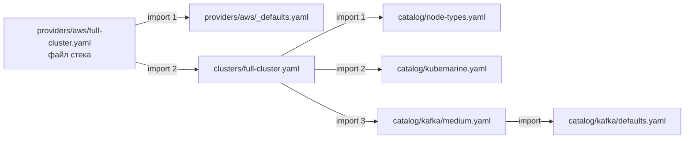
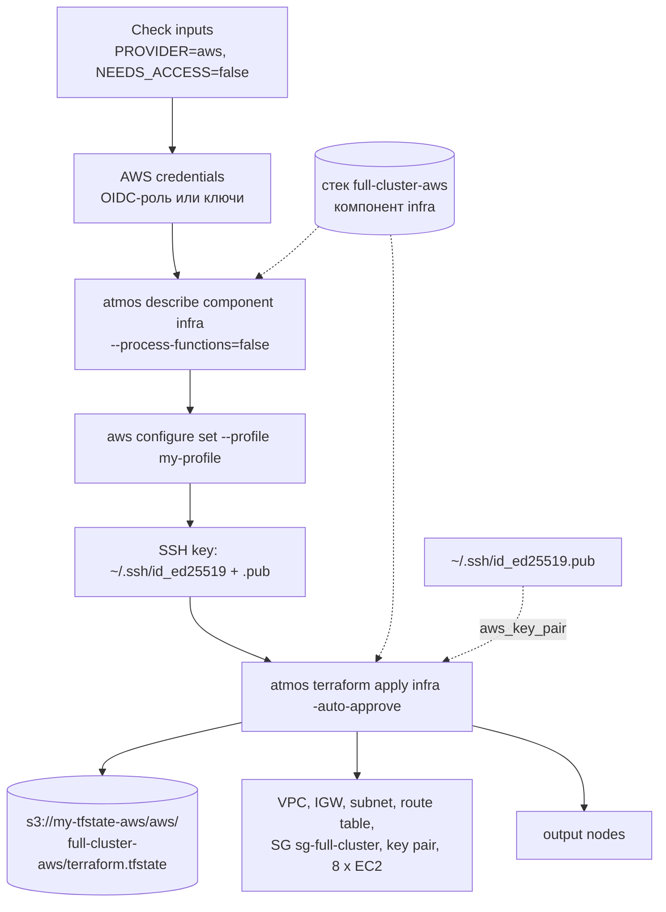
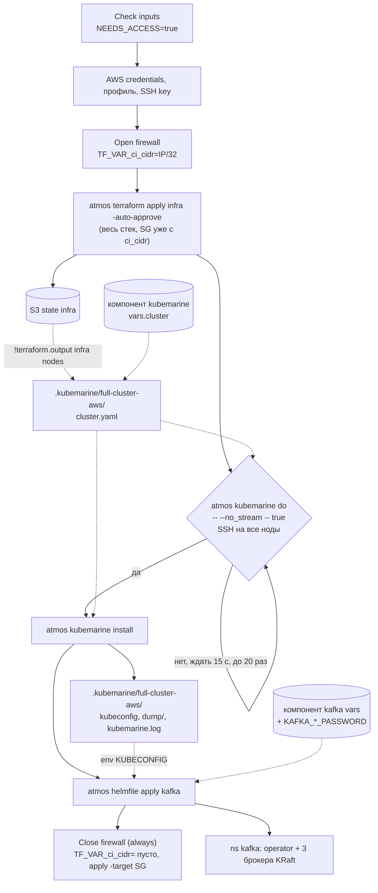
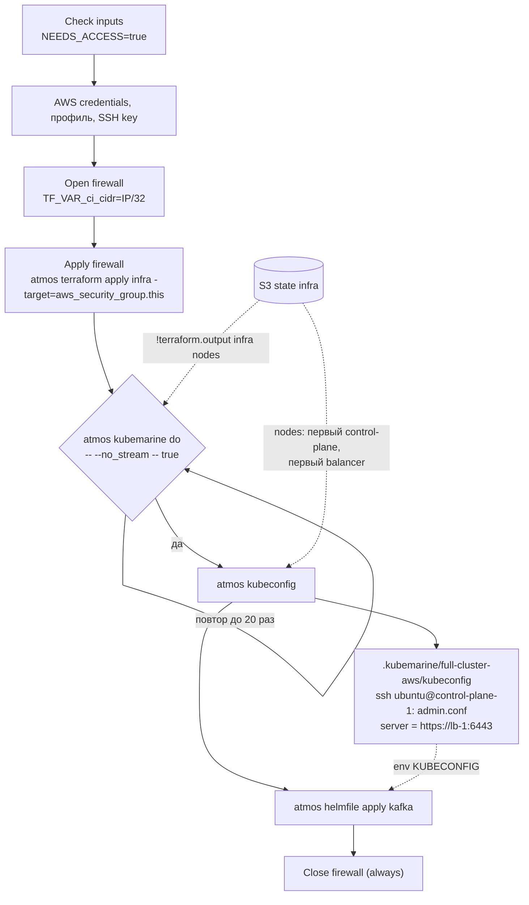
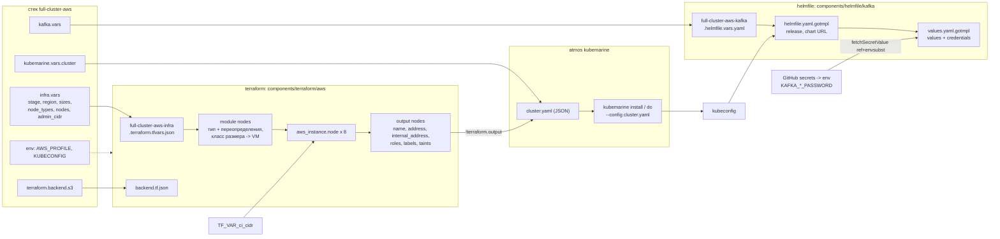

# Конвейер full-cluster-aws: стек, команды, конфиги

Как workflow [`cluster`](../.github/workflows/cluster.yaml) собирает стек atmos `full-cluster-aws`, какие команды запускает при
`action=infra`, `deploy` и `apps`, и из каких файлов и переменных получаются конфиги terraform, kubemarine и helmfile.

Файл стека [`stacks/providers/aws/full-cluster.yaml`](../stacks/providers/aws/full-cluster.yaml) только размещает кластер в облаке:

```yaml
import:
  - providers/aws/_defaults
  - clusters/full-cluster
```

Так же устроены `full-cluster-azure`, `full-cluster-gcp`, `full-cluster-openstack` и все `test-*`; отличаются только импортируемые
`providers/<cloud>/_defaults`. Всё ниже переносится на другие облака заменой папки terraform, backend, env и классов размеров.

## 1. Сборка стека: импорты и порядок мёржа

atmos берёт файлы из `stacks/providers/**/*` кроме `_defaults.yaml` (`atmos.yaml` → `stacks.included_paths`).
Имя стека = `{{ .vars.stage }}-{{ .settings.provider }}` = `full-cluster` + `aws`. Импорты разворачиваются в глубину, по порядку;
содержимое файла ложится поверх его импортов. Слияние глубокое: словари мёржатся по ключам, списки и скаляры заменяются целиком.



Итоговый порядок (каждый следующий слой перекрывает предыдущие):

| # | Слой | Что задаёт |
|---|---|---|
| 1 | `providers/aws/_defaults` | `settings.provider: aws`, `env.AWS_PROFILE`, `terraform.backend.s3`, `infra.metadata.component: aws`, `infra.vars.region`, `infra.vars.sizes` |
| 2 | `catalog/node-types` | `infra.vars.node_types`: balancer / control-plane / worker |
| 3 | `catalog/kubemarine` | глобальный `env.KUBECONFIG`; абстрактный компонент `kubemarine`: базовый `vars.cluster` (node_defaults, `nodes: !terraform.output infra nodes`, calico vxlan, local-path), `vars.procedures: {}` |
| 4 | `catalog/kafka/defaults` | `kafka.vars`: chart_version, release_name, namespace, credentials (`ref+envsubst://…`), базовые values |
| 5 | `catalog/kafka/medium` | профиль Medium: replicas 3, heap 2048, resources, storage 500Gi, environmentVariables, operator |
| 6 | `clusters/full-cluster` (свой контент) | `vars.stage: full-cluster`; infra: `admin_cidr`, тип `infra-worker`, 8 нод; kubemarine: cluster_name, services, rbac, plugins |
| 7 | `providers/aws/full-cluster` (свой контент) | пусто; место для правок только этой пары «кластер × облако» |

Внутри каждого компонента atmos ещё раз наслаивает секции: глобальные `vars` / `env` / `settings` → секция типа (`terraform:`, `helmfile:`)
→ `components.<type>.<name>`. Затем рендерит Go-шаблоны с разделителями `<% %>` (так `KUBECONFIG` получает имя стека),
а YAML-функции вроде `!terraform.output` выполняет в момент запроса компонента.

### Что получает каждый компонент и откуда

Проверить: `atmos describe component <infra|kubemarine|kafka> -s full-cluster-aws --process-functions=false`.

| Компонент | Ключ | Значение в full-cluster-aws | Источник |
|---|---|---|---|
| **infra** (`components/terraform/aws`) | `metadata.component` | `aws` (папка terraform) | providers/aws/_defaults |
| | `vars.stage` | `full-cluster` | clusters/full-cluster (глобальные vars) |
| | `vars.region`, `vars.sizes` | `eu-central-1`; small→t3.small, medium→t3.xlarge, large→m6i.2xlarge, xlarge→m6i.4xlarge | providers/aws/_defaults |
| | `vars.node_types` | balancer, control-plane, worker + infra-worker | catalog/node-types + clusters/full-cluster |
| | `vars.nodes`, `vars.admin_cidr` | 8 нод; `72.56.49.160/28` | clusters/full-cluster |
| | `ci_cidr` | IP раннера/32 или пусто | env `TF_VAR_ci_cidr` из workflow |
| | `cidr`, `admin_ports`, `ssh_public_key_file` | `10.10.0.0/24`, `[22, 6443]`, `~/.ssh/id_ed25519.pub` | дефолты variables.tf |
| | `backend` | s3 `my-tfstate-aws`, key `terraform.tfstate`, `workspace_key_prefix: aws` (добавляет atmos), workspace `full-cluster-aws` | providers/aws/_defaults + atmos |
| | `env` | `AWS_PROFILE=my-profile`, `KUBECONFIG=…` (глобальный, terraform его не использует) | providers/aws/_defaults, catalog/kubemarine |
| **kubemarine** (abstract, без папки) | `vars.cluster` | база + full-cluster: cluster_name `full-cluster.k8s.local`, services, rbac, plugins (calico mode vxlan + typha/apiserver из кластера) | catalog/kubemarine ⊕ clusters/full-cluster |
| | `vars.cluster.nodes` | `!terraform.output infra nodes`: 8 записей из state | S3 state компонента infra |
| | `vars.procedures` | `{}`: procedure.yaml не пишется | catalog/kubemarine |
| **kafka** (`components/helmfile/kafka`) | `vars` | chart 2.8.4, release `kafka`, ns `kafka`, credentials, values (defaults ⊕ medium), stage | catalog/kafka/defaults ⊕ medium |
| | `env.KUBECONFIG` | `../../../.kubemarine/full-cluster-aws/kubeconfig` (от папки компонента) | catalog/kubemarine (шаблон `<% .atmos_stack %>`) |
| | секреты | `$KAFKA_ADMIN_PASSWORD`, `$KAFKA_CLIENT_PASSWORD` | GitHub secrets → `env:` workflow |

## 2. Какие шаги workflow выполняются при каждом action

Общие шаги для всех трёх action: Inputs (summary), checkout, установка terraform / atmos / helm / kubemarine / helmfile / helm-diff,
AWS credentials, создание профиля `my-profile`, SSH-ключ. «Check inputs» вычисляет `PROVIDER=aws` (суффикс имени стека),
`FIREWALL=aws_security_group.this` и `NEEDS_ACCESS`.

| Шаг | infra | deploy | apps |
|---|---|---|---|
| `NEEDS_ACCESS` | false | true | true |
| AWS profile named in the stack | `atmos describe component infra -s full-cluster-aws --process-functions=false` → `.env.AWS_PROFILE` → `aws configure set … --profile my-profile` | то же | то же |
| Open cluster firewall | — | `TF_VAR_ci_cidr=<IP раннера>/32` → `$GITHUB_ENV` | то же |
| Apply firewall | — | — (весь apply ниже) | `atmos terraform apply infra -s full-cluster-aws -auto-approve -target=aws_security_group.this` |
| terraform apply | `atmos terraform apply infra -s full-cluster-aws -auto-approve` | то же | — |
| Wait for SSH on all nodes | — | до 20 раз через 15 с: `atmos kubemarine do -s full-cluster-aws -- --no_stream -- true` | то же |
| kubemarine install | — | `atmos kubemarine install -s full-cluster-aws --dry-run=false` | — |
| kubeconfig | — | — (пишет install) | `atmos kubeconfig -s full-cluster-aws` |
| helmfile apply | — | для каждого `app` из input `apps` (по умолчанию `kafka`): проверка секретов → `atmos helmfile apply kafka -s full-cluster-aws` | то же |
| Close cluster firewall (always) | — | `atmos terraform state list infra` → есть SG? → `TF_VAR_ci_cidr="" atmos terraform apply infra -auto-approve -target=aws_security_group.this` | то же |

### action = infra



### action = deploy



### action = apps



В apps kubeconfig берётся с ноды, потому что `.kubemarine/` не в git и на свежем раннере его нет. Ноды в output идут в порядке
ключей map: `control-plane-1…3`, `lb-1`, `lb-2`, `worker-1…3`, поэтому «первый» control-plane = `control-plane-1`,
API = публичный IP `lb-1`.

### Режим dry_run=true

- `NEEDS_ACCESS` = false: firewall не трогается, Wait for SSH и kubeconfig пропускаются.
- infra / deploy: `atmos terraform plan infra` вместо apply.
- deploy: `atmos kubemarine install --dry-run=true` только печатает cluster.yaml и команду. Ноды берутся из текущего state, а не из плана.
- deploy / apps: `atmos helmfile template kafka` офлайн, в лог идёт только список ресурсов (в манифестах секреты).

## 3. Как строятся конфиги инструментов



### terraform · infra

1. atmos пишет в `components/terraform/aws/`: `full-cluster-aws-infra.terraform.tfvars.json` из `vars` и `backend.tf.json`
   из `backend` (`auto_generate_backend_file`).
2. Экспортирует `env` стека (`AWS_PROFILE`), плюс `TF_VAR_ci_cidr` из окружения раннера.
3. `terraform init -reconfigure` (`deploy_run_init`, `init_run_reconfigure`) → workspace `full-cluster-aws` → `apply -var-file …`.
   Summary пишет atmos CI.
4. [`modules/nodes`](../components/terraform/modules/nodes/main.tf): нода = тип + переопределения, `labels` мёржатся,
   `taints` заменяются, `size` идёт через `sizes`.
5. Всем ресурсам ставится тег `cost-usage = full-cluster`, имена с префиксом `stage`.

| нода | тип | VM | extra |
|---|---|---|---|
| lb-1, lb-2 | balancer | t3.small | |
| control-plane-1..3 | control-plane | t3.xlarge | |
| worker-1 | worker | m6i.2xlarge | taint add-example |
| worker-2 | infra-worker | m6i.2xlarge | netcracker-infra=infra, region=europe |
| worker-3 | infra-worker | m6i.2xlarge | netcracker-infra=infra, region=asia |

Диск у всех 50 GB (дефолт `disk_size`).

### kubemarine · custom command

1. `component_config` в `atmos.yaml` запрашивает компонент `kubemarine` стека. Он abstract, terraform для него не запускается.
2. При этом выполняется `!terraform.output infra nodes`: atmos читает output из S3 state infra. Нужны AWS-креды, и так при каждом
   вызове, включая каждую попытку Wait for SSH.
3. Шаг шаблона: `$cluster = vars.cluster`, `$cfg = vars.procedures[<procedure>]` (для install/do пусто). Ветка add_node/remove_node
   с `--nodes` здесь не используется.
4. В `.kubemarine/full-cluster-aws/` пишет `cluster.yaml` (`toJson`, валидный YAML) и запускает
   `kubemarine <proc> --config cluster.yaml <trailing args>`.
5. В CI (`GITHUB_STEP_SUMMARY` задан) вывод идёт через `tee kubemarine.log`, в summary попадают статус, время и последние 200 строк.

Состав cluster.yaml: `cluster_name`, `node_defaults` (ubuntu, `~/.ssh/id_ed25519`), `nodes` из output, `services`
(kubeadm v1.34.2, resolv.conf, ntp, apparmor, haproxy, packages), `rbac` (accounts, PSS restricted), `plugins`
(calico vxlan + apiserver, local-path-provisioner, nginx-ingress, dashboard).

`atmos kubeconfig` берёт тот же `vars.cluster`: SSH-пользователя и ключ из `node_defaults`, адреса из `nodes`.

### helmfile · kafka

1. atmos пишет `components/helmfile/kafka/full-cluster-aws-kafka.helmfile.vars.yaml` из `vars` компонента.
2. Экспортирует `env`: `KUBECONFIG=../../../.kubemarine/full-cluster-aws/kubeconfig` (cwd = папка компонента).
   `use_eks: false`, поэтому EKS-kubeconfig не генерируется.
3. `helmfile --state-values-file <varfile> apply`: helm-diff, затем upgrade --install.
4. [`helmfile.yaml.gotmpl`](../components/helmfile/kafka/helmfile.yaml.gotmpl): release `kafka`, ns `kafka`, chart = GitHub release
   `kafka-2.8.4.tgz`, `wait`, timeout 900, `disableValidationOnInstall`.
5. [`values.yaml.gotmpl`](../components/helmfile/kafka/values.yaml.gotmpl): `.Values.values` ⊕ `global.secrets.kafka`;
   пароли резолвит `fetchSecretValue` (vals) из `ref+envsubst://$KAFKA_*_PASSWORD`.

Итоговые values: `global.monitoringType: prometheus`, `kafka.kraft.enabled`, `replicas: 3`, `heapSize: 2048`, 1–2 CPU / 8Gi,
`storage.className: [local-path]`, `size: 500Gi`, operator 100–200m / 128–256Mi.

Перед запуском workflow проверяет, что оба секрета Kafka не пустые.

## 4. Точки расширения

| Где | Что можно менять | На что влияет |
|---|---|---|
| `providers/aws/full-cluster.yaml` | свой контент поверх всех импортов: `infra.vars.region` / `sizes` / `admin_cidr`, `env.AWS_PROFILE`, правки `kafka.vars.values` | только full-cluster-aws |
| `providers/aws/_defaults.yaml` | backend s3, профиль, регион, классы размеров → типы EC2 | все кластеры в AWS |
| `clusters/full-cluster.yaml` | топология (`nodes`, свои `node_types`), содержимое cluster.yaml, выбор профиля kafka через import | full-cluster во всех облаках |
| `catalog/node-types.yaml` | базовые roles / size / disk_size / labels / taints | все кластеры |
| `catalog/kubemarine.yaml` | общий `vars.cluster`; `vars.procedures.<name>` → procedure.yaml (upgrade, backup и т. п., в этих трёх action не используется) | все кластеры |
| `catalog/kafka/*.yaml` | профили размеров; `credentials` можно переключить на `ref+awssecrets://…` без правок helmfile | кластеры, импортирующие профиль |
| `components/terraform/aws/variables.tf` | дефолты `cidr`, `admin_ports`, `ssh_public_key_file`, переопределяются через `infra.vars` в стеке | VPC, SG, key pair |
| новое приложение | `components/helmfile/<app>/` + `catalog/<app>/` + import в кластере + input `apps: "kafka <app>"`; секреты добавить в `env:` workflow | шаг helmfile в deploy / apps |
| `atmos.yaml` → `commands` | логика рендера cluster.yaml / procedure.yaml, формат summary, получение kubeconfig | все вызовы `atmos kubemarine` / `atmos kubeconfig` |
| input `kubemarine` (action=kubemarine) | хвост `-- <args>` передаётся kubemarine как есть, например `install -- --tasks deploy.plugins` | вне трёх рассмотренных action |
| секции atmos `overrides`, `hooks` | в репо не используются; `overrides` правит компоненты только из своего файла, `hooks` срабатывают на события terraform | резерв |

Локальный аналог deploy без apps: atmos workflow [`stacks/workflows/cluster.yaml`](../stacks/workflows/cluster.yaml)
(`terraform apply infra` → `kubemarine install`). GitHub workflow его не вызывает.
